Welcome to my amateur gallery!

## Mountain & Wild Nature

<table style="width: 100%; border: none !important; border-collapse: collapse; margin-top: 10px;">
  <!-- RIGA 1: PAESAGGI CLASSICI -->
  <tr style="border: none !important;">
    <!-- FOTO: MARMOLADA -->
    <td style="width: 50%; vertical-align: top; border: none !important; padding: 0 10px 20px 0;">
      <a href="/assets/images/DSC_0050.JPG" target="_blank">
        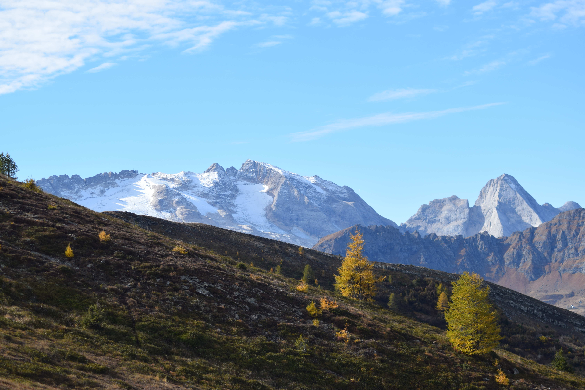
      </a>
      <strong style="color: #134074; display: block; font-size: 1.1em;">Marmolada</strong>
      The majestic peak covered with the very first autumn snow.
    </td>
    <!-- FOTO: COL DI LANA -->
    <td style="width: 50%; vertical-align: top; border: none !important; padding: 0 0 20px 10px;">
      <a href="/assets/images/DSC_0029.JPG" target="_blank">
        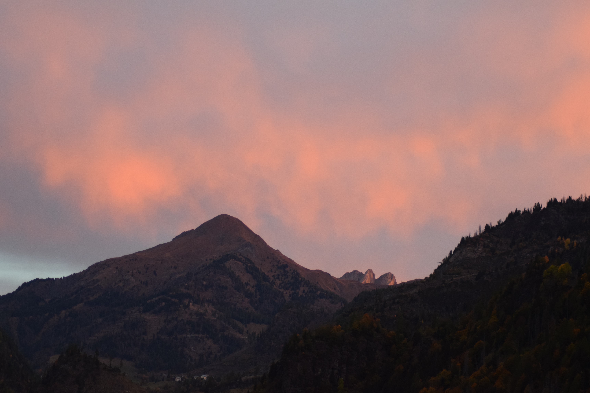
      </a>
      <strong style="color: #134074; display: block; font-size: 1.1em;">Monte Col di Lana</strong>
      A breathtaking view captured during sunrise.
    </td>
  </tr>
  
  <!-- RIGA 2: FORCELLA PIANEZZE & SECONDO SCATTO -->
  <tr style="border: none !important;">
    <!-- FOTO: FORCELLA PIANEZZE -->
    <td style="width: 50%; vertical-align: top; border: none !important; padding: 0 10px 20px 0;">
      <a href="/assets/images/DSC_0107.JPG" target="_blank">
        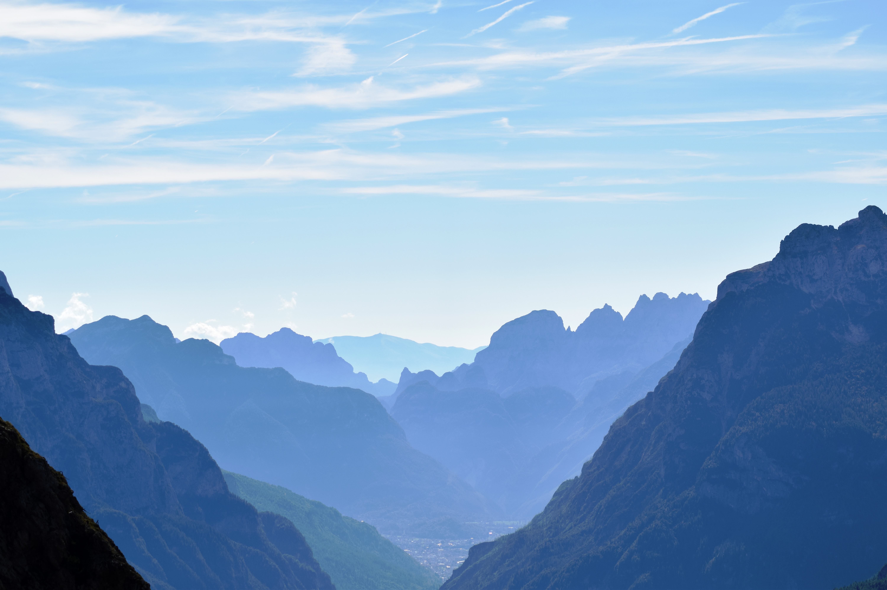
      </a>
      <strong style="color: #134074; display: block; font-size: 1.1em;">Forcella Pianezza</strong>
      The peaks visible from Forcella Pianezze.
    </td>
    <!-- FOTO: STELLA ALPINA (Spostata qui per bilanciare la griglia della natura montana) -->
    <td style="width: 50%; vertical-align: top; border: none !important; padding: 0 0 20px 10px;">
      <a href="/assets/images/DSC_0083.JPG" target="_blank">
        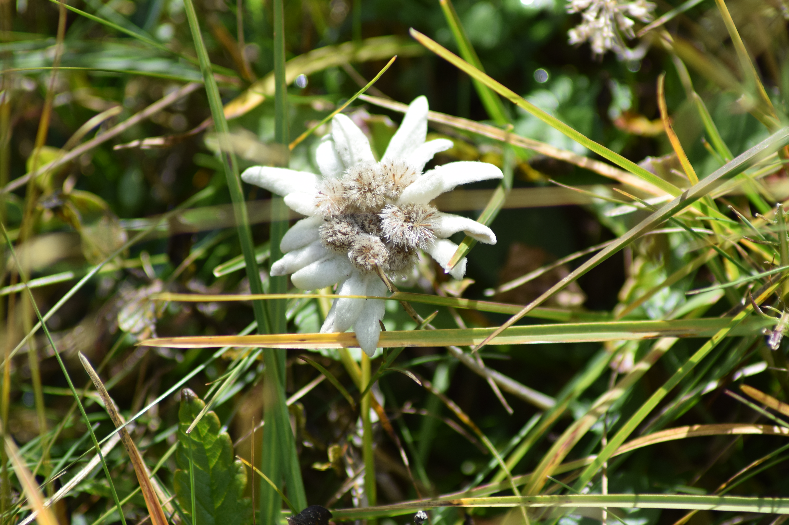
      </a>
      <strong style="color: #134074; display: block; font-size: 1.1em;">Edelweiss (Stella Alpina)</strong>
      A rare and beautiful alpine flower growing among the rocks.
    </td>
  </tr>

  <!-- RIGA 3: LE DUE MARMOTTE -->
  <tr style="border: none !important;">
    <!-- FOTO: MARMOTTA 1 -->
    <td style="width: 50%; vertical-align: top; border: none !important; padding: 0 10px 20px 0;">
      <a href="/assets/images/DSC_0644.JPG" target="_blank">
        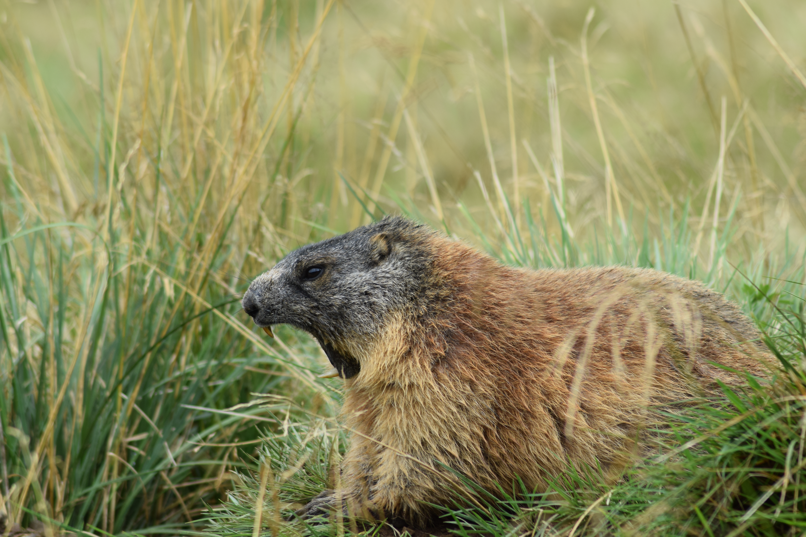
      </a>
      <strong style="color: #134074; display: block; font-size: 1.1em;">Marmot (Close-up)</strong>
      A close-up shot taken during a mountain hike.
    </td>
    <!-- FOTO: MARMOTTA 2 -->
    <td style="width: 50%; vertical-align: top; border: none !important; padding: 0 0 20px 10px;">
      <a href="/assets/images/DSC_0167.JPG" target="_blank">
        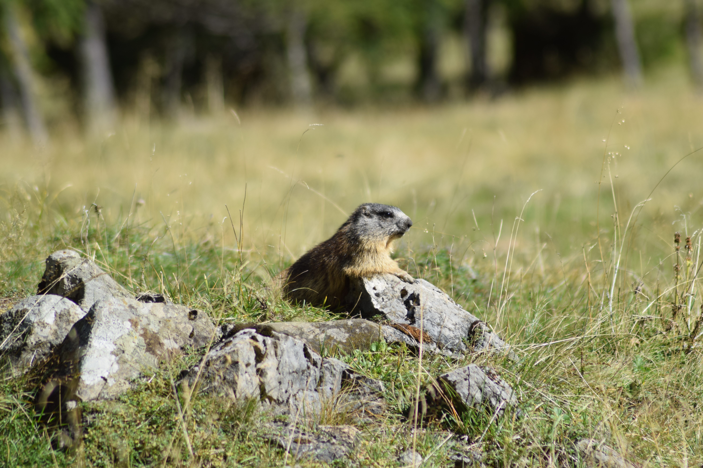
      </a>
      <strong style="color: #134074; display: block; font-size: 1.1em;">Marmot in the Sun</strong>
      Another marmotta encounter high up in the valleys.
    </td>
  </tr>

  <!-- RIGA 4: FUNGO ED EVENTUALI SCATTI FUTURI -->
  <tr style="border: none !important;">
    <!-- FOTO: FUNGO (AMANITA MUSCARIA) -->
    <td style="width: 50%; vertical-align: top; border: none !important; padding: 0 10px 20px 0;">
      <a href="/assets/images/DSC_0079.JPG" target="_blank">
        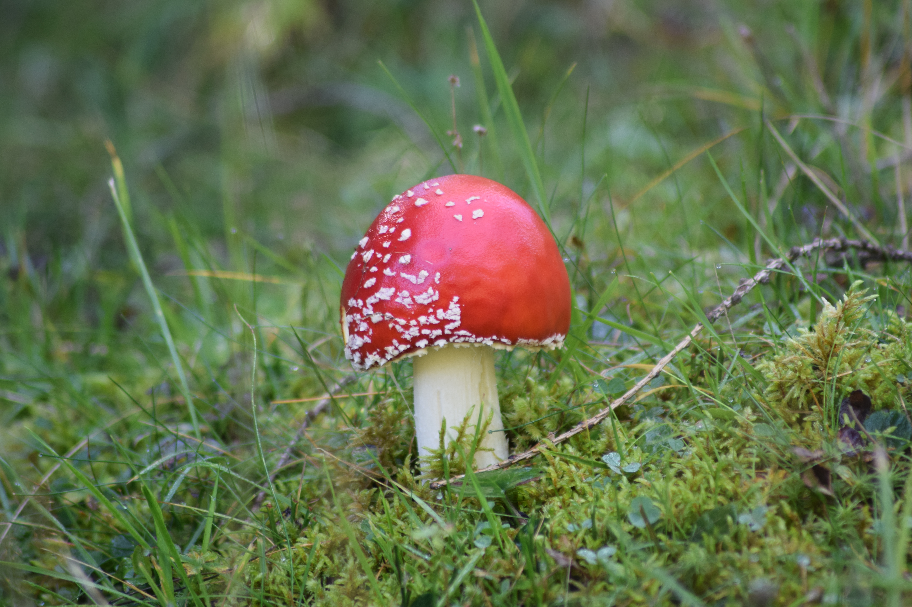
      </a>
      <strong style="color: #134074; display: block; font-size: 1.1em;">Amanita Muscaria</strong>
      The iconic red and white fairytale mushroom found nestled in the alpine moss.
    </td>
    <!-- SPAZIO VUOTO NELLA GRIGLIA NATURA PER AGGIORNAMENTI FUTURI -->
    <td style="width: 50%; vertical-align: top; border: none !important; padding: 0 0 20px 10px;">
    </td>
  </tr>
</table>

## Everyday Beauty

<table style="width: 100%; border: none !important; border-collapse: collapse; margin-top: 10px;">
  <tr style="border: none !important;">
    <!-- FOTO: ALBA PADOVA -->
    <td style="width: 50%; vertical-align: top; border: none !important; padding: 0 10px 20px 0;">
      <a href="/assets/images/DSC_0001.JPG" target="_blank">
        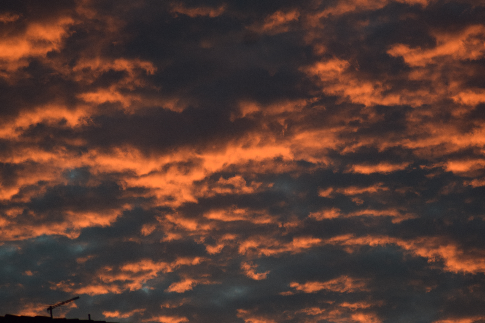
      </a>
      <strong style="color: #134074; display: block; font-size: 1.1em;">Padova at Dawn</strong>
      The golden hour painting the sky over Padova early in the morning.
    </td>
    <!-- FOTO: ALBERO AUTUNNALE (LIQUIDAMBAR) -->
    <td style="width: 50%; vertical-align: top; border: none !important; padding: 0 0 20px 10px;">
      <a href="/assets/images/DSC_0052.JPG" target="_blank">
        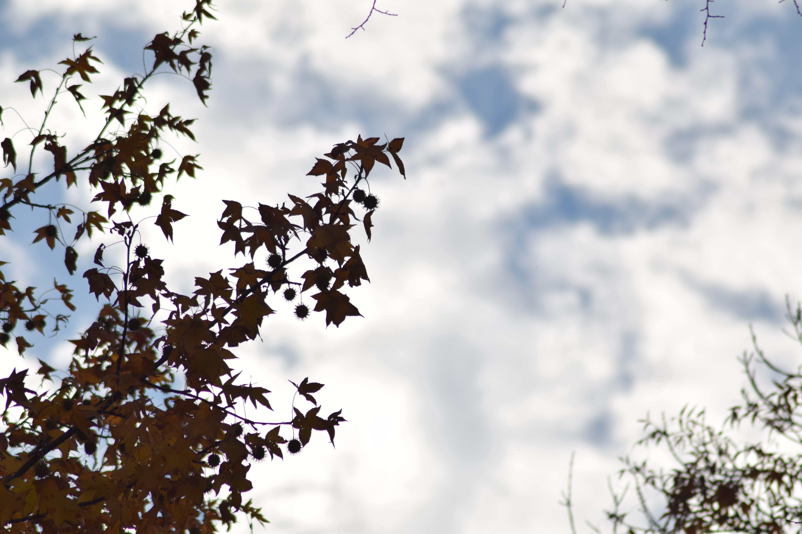
      </a>
      <strong style="color: #134074; display: block; font-size: 1.1em;">Liquidambar in Autumn</strong>
      The silhouette of a Liquidambar tree, showcasing its unique spiky seed balls and warm November hues.
    </td>
  </tr>
</table>

## Travel & Places

<table style="width: 100%; border: none !important; border-collapse: collapse; margin-top: 10px;">
  <tr style="border: none !important;">
    <!-- FOTO: MONTI BALCANI -->
    <td style="width: 50%; vertical-align: top; border: none !important; padding: 0 10px 20px 0;">
      <a href="/assets/images/DSC_0395.JPG" target="_blank">
        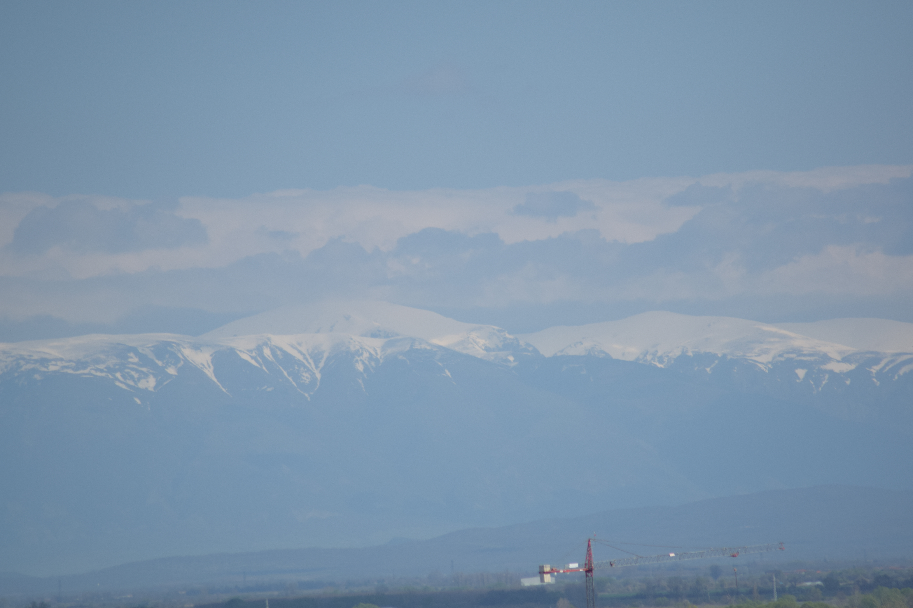
      </a>
      <strong style="color: #134074; display: block; font-size: 1.1em;">Balkan Mountains</strong>
      The snowy peaks of Stara Planina, captured from Plovdiv, Bulgaria.
    </td>
    <!-- FOTO: SCOIATTOLO LONDRA -->
    <td style="width: 50%; vertical-align: top; border: none !important; padding: 0 0 20px 10px;">
      <a href="/assets/images/SCOIATTOLO.jpeg" target="_blank">
        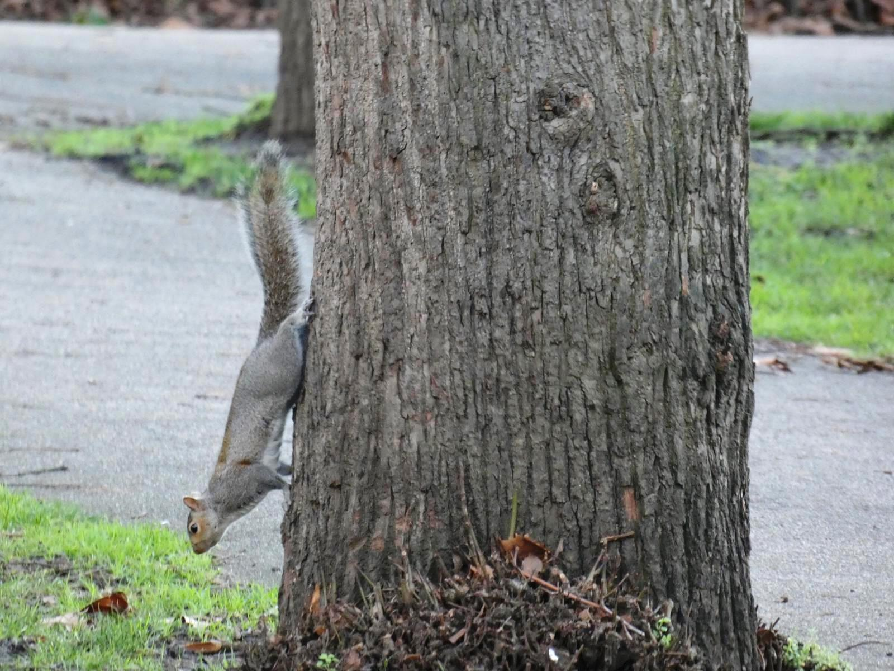
      </a>
      <strong style="color: #134074; display: block; font-size: 1.1em;">Squirrel in London</strong>
      A friendly little squirrel encountered in Hyde Park, London.
    </td>
  </tr>
</table>
